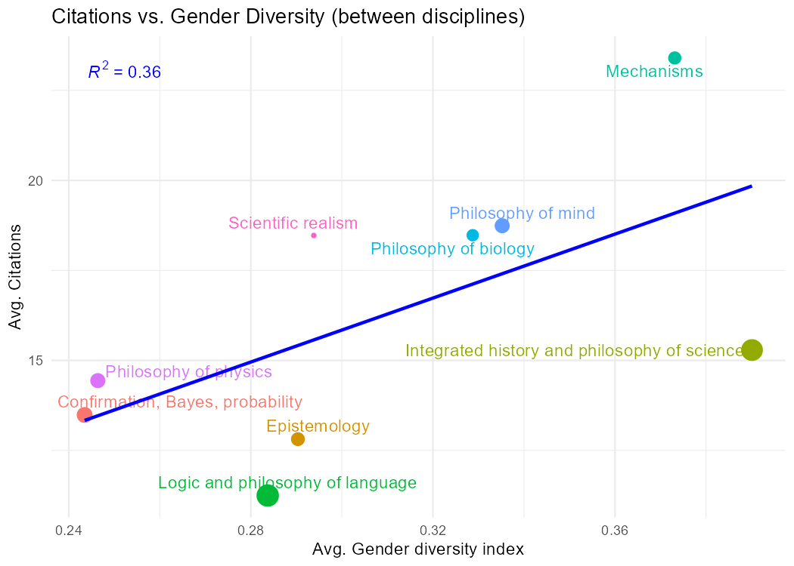
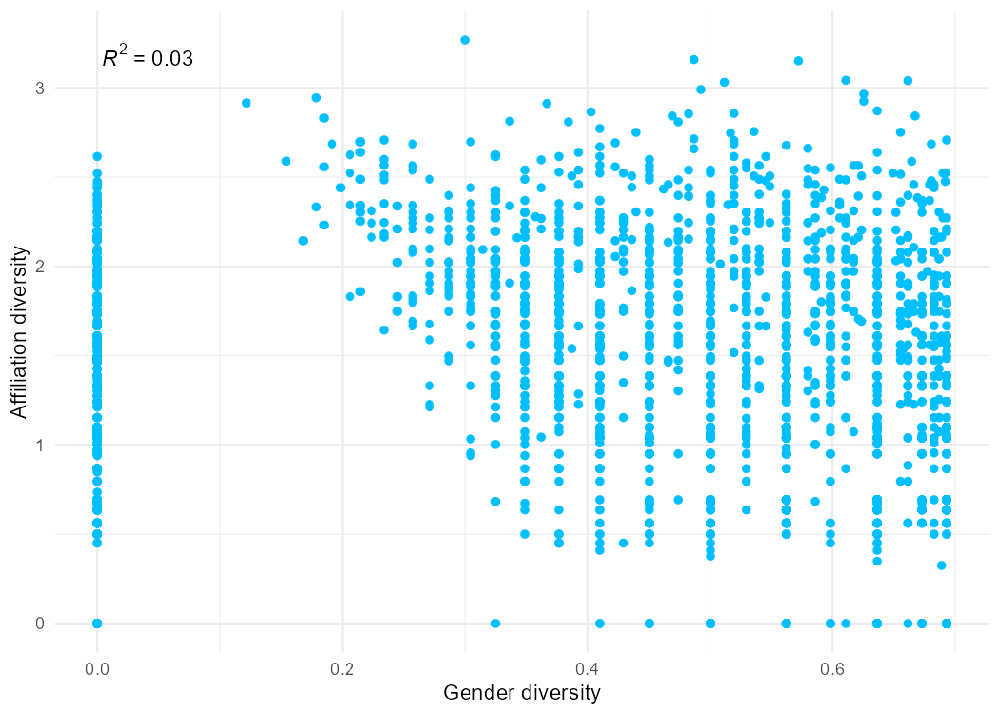

# Gender and affiliation diversity in philosophy of science

An R analysis of whether the **gender** and **institutional diversity** of the people behind a journal article (its authors *and* the colleagues acknowledged in it) is associated with how often the article is cited.

**[Read the full report online →](https://github.com/sprologuglie/A-scientometric-analysis-of-the-diversity-thesis-in-philosophy-of-science)**

## At a glance

| | |
|---|---|
| **Question** | Do more gender-diverse or more institutionally diverse teams receive more citations? |
| **Unit of analysis** | Journal article with at least two contributors, published 2005–2019 in 8 journals (5,174 articles; 5,110 after removing missing values) |
| **Contributors** | Authors + acknowledgees, merged into a single set |
| **Diversity measure** | Shannon entropy of gender (male/female) and of institutional affiliation within each article |
| **Model** | Negative binomial regression with fixed effects for journal, publication year and sub-field cluster (`fixest::fenegbin`) |
| **Controls** | Team size, number of prize winners, number of contributors holding official roles in associations |
| **Language / tools** | R, R Markdown, `tidyverse`, `fixest`, `vegan`, `modelsummary`, `ggplot2` |

## Main results

Estimates from the original run (negative binomial with journal, year and sub-field fixed effects; IRR = incidence rate ratio, i.e. the multiplicative change in expected citations per one-unit increase of the predictor; 95% intervals computed as coefficient ± 1.96 SE, with i.i.d. standard errors):

| Predictor | Coefficient | IRR | 95% CI |
|---|---|---|---|
| Affiliation diversity | 0.185 | 1.20 | 1.13 – 1.28 |
| Gender diversity | 0.093 | 1.10 | 0.99 – 1.22 |
| Team size | 0.016 | 1.02 | 1.01 – 1.03 |
| Prize winners | −0.029 | 0.97 | 0.92 – 1.03 |
| Official roles | 0.057 | 1.06 | 1.02 – 1.10 |

- **Affiliation diversity** is positively associated with citations, even after controlling for team size and the fixed effects.
- **Gender diversity** has a positive but not conventionally significant coefficient. Between sub-fields, the more gender-diverse ones are on average more cited, but within sub-fields the relationship is flat. The between-field pattern rests on only about nine sub-fields and is purely descriptive.
- The two diversity indices are almost uncorrelated (R² ≈ 0.03) and their coefficients barely change when entered in separate models, which is consistent with additive effects.

<p align="center">
  
  
</p>

*The two figures are regenerated each time the report is built.*

## Repository structure

```
.
├── analysis/
│   └── diversity_analysis.Rmd   # full pipeline: data wrangling → indices → models → plots
├── build_report.R               # renders the report to docs/index.html
├── data/
│   └── README.md                # expected input tables (the data themselves are not versioned)
├── docs/
│   └── index.html               # rendered report, served by GitHub Pages
├── figures/                     # figures used in this README
└── README.md
```

## How to reproduce

1. Install R (≥ 4.1) and the packages

   ```r
   install.packages(c(
     "broom.mixed", "dplyr", "tidyr", "readr", "ggplot2", "ggpmisc", "ggrepel",
     "fixest", "vegan", "reactable", "modelsummary", "tinytable", "here",
     "rmarkdown"
   ))
   ```

2. Put the input tables in `data/` (Download the SOPHIS database at https://zenodo.org/records/17277030).

3. Knit the diversity_analysis.Rmd file

## Data

The analysis runs on tables from the **SOPHIS database** plus a CSV of article records with citation counts. They are not included in this repository: they contain information about named individuals (gender, affiliations) and bibliographic records that may be subject to third-party licences. The rendered report only embeds 10-row previews and aggregate tables, not the article-level data.

## Methodological notes and limitations

- **Standard errors.** The main results use i.i.d. standard errors. With only a handful of journals and publication years, more robust inference techniques would be a natural next step.
- **Comparability of the indices.** Shannon entropy of a binary variable (gender, maximum ≈ 0.69) and of a many-category variable (institutions) live on different scales, so "per one unit" coefficients are not directly comparable between the two. Standardising the indices would make the comparison fairer.
- **Citations as an outcome.** Citation counts are a proxy for impact and depend on field, age and visibility; fixed effects absorb part of this but not all.
- **Observational design.** The estimates are associations, not causal effects: collaboration choices and institutional prestige may be confounded with citation potential.
- **Missing data.** Articles without gender or affiliation information, or without a sub-field cluster, drop out of the models; all models are fitted on the same complete-case sample.

